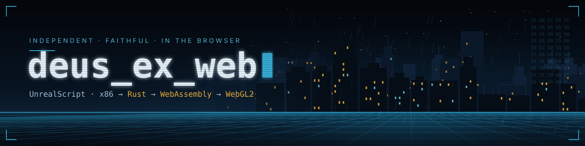
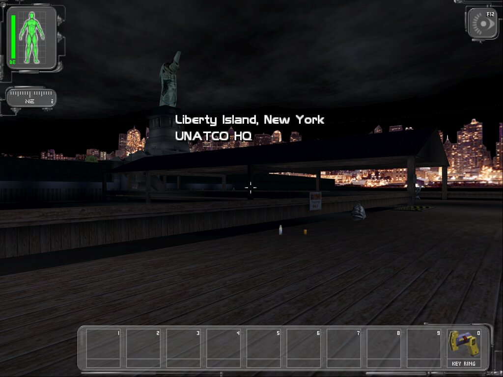
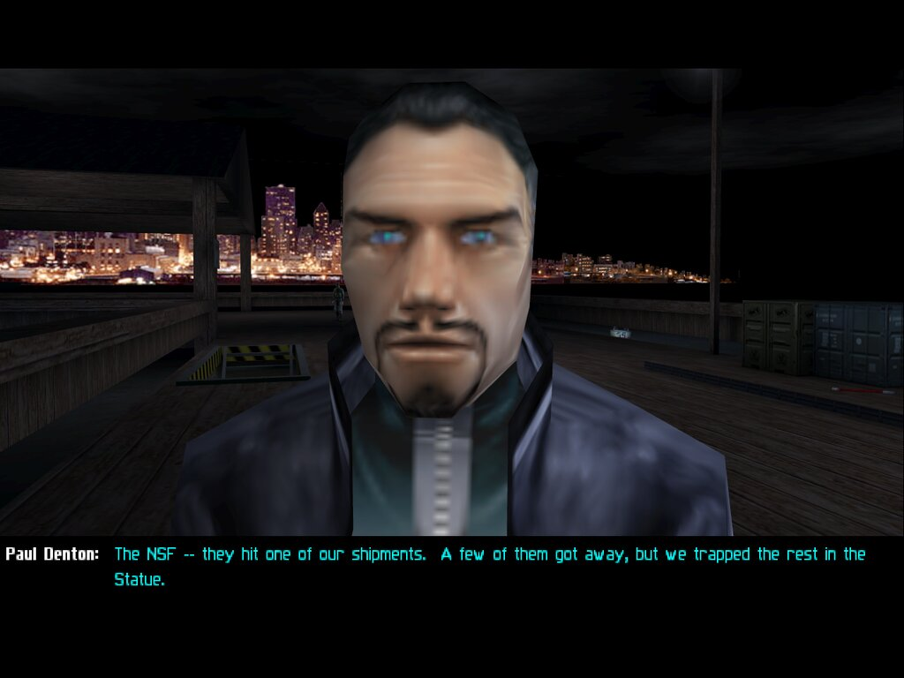
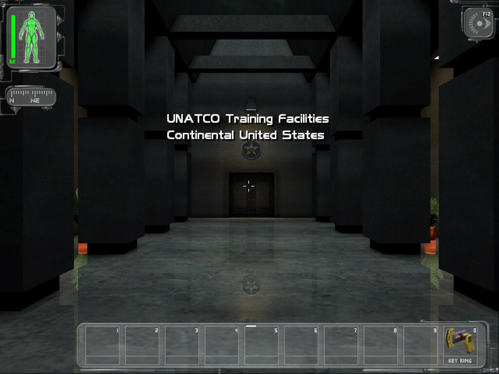
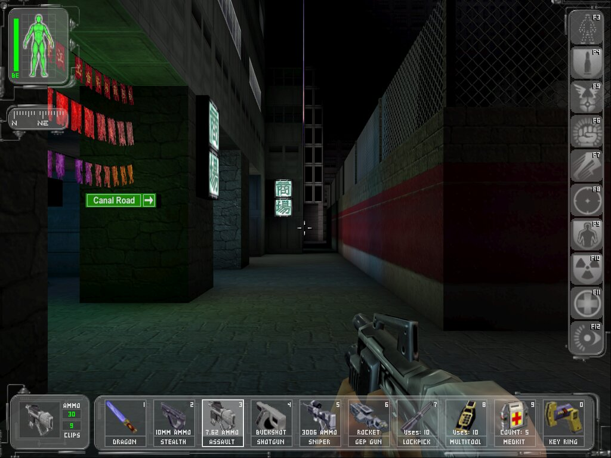
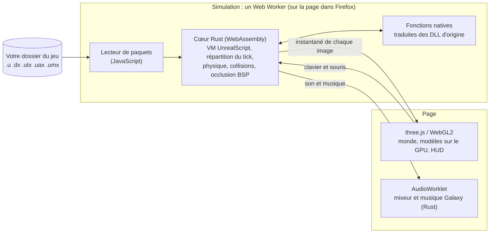

<p align="center">
  
</p>

<p align="center">
  <a href="README.md">English</a> · <strong>Français</strong> · <a href="README.zh-CN.md">简体中文</a>
</p>

# Deus Ex sur le web

Une réimplémentation indépendante de **Deus Ex** (Ion Storm, 2000) qui tourne dans un
navigateur de bureau et vise à se comporter exactement comme le jeu original.

Ce n'est pas un remake, et le jeu Windows n'est pas émulé. Votre propre copie du jeu
fournit les cartes, les textures, les sons, la musique et l'UnrealScript compilé. Le projet
exécute ce bytecode dans sa propre machine virtuelle et réimplémente le code natif du
moteur à partir de l'analyse des binaires x86 d'origine. Chaque comportement est comparé à
l'original : ses DLL tournent dans un émulateur de processeur pour des comparaisons
fonction par fonction, et le jeu lui-même tourne sous Wine pour enregistrer des traces et
des images de référence.

Le cœur de la simulation est écrit en **Rust et compilé en WebAssembly**. JavaScript fait
le lien avec le navigateur : **three.js et WebGL2** dessinent l'image, **Web Audio** joue
le son et la musique, et un **Web Worker** fait tourner la simulation hors du fil principal
de la page.

> [!IMPORTANT]
> Ce dépôt ne contient **aucun fichier du jeu**. Pour jouer, il vous faut votre propre
> copie de Deus Ex, obtenue légalement, par exemple *Deus Ex: Game of the Year Edition*
> sur GOG ou Steam. Voir les [mentions légales](#mentions-légales).

<table>
  <tr>
    <td width="50%"></td>
    <td width="50%"></td>
  </tr>
  <tr>
    <td align="center"><sub>Liberty Island au début de la première mission</sub></td>
    <td align="center"><sub>La rencontre avec Paul : la caméra de dialogue et les sous-titres</sub></td>
  </tr>
  <tr>
    <td width="50%"></td>
    <td width="50%"></td>
  </tr>
  <tr>
    <td align="center"><sub>Le centre d'entraînement</sub></td>
    <td align="center"><sub>Le marché de Wan Chai à Hong Kong : le HUD, avec l'équipement de la page de débogage</sub></td>
  </tr>
</table>

<sub>Captures de la version navigateur dans Chromium sous Linux, au format 4:3 de l'original. Elles montrent les
graphismes d'origine du jeu, lus depuis une copie locale du jeu.</sub>

**Sommaire :** [État](#état) · [Démarrage](#démarrage) · [Commandes](#commandes) ·
[Sauvegardes](#sauvegardes) · [Fonctionnement](#fonctionnement) ·
[Vérifier la fidélité](#vérifier-la-fidélité) · [Performances](#performances) ·
[Contribuer](#contribuer) · [Documentation](#documentation) ·
[Mentions légales](#mentions-légales) · [Licence](#licence)

La documentation détaillée du dossier `docs/` est en anglais.

## État

Le travail est découpé en étapes ([feuille de route](docs/roadmap.md)). Chaque étape se
clôt sur une liste fixe de critères. Pour le comportement du jeu, chaque critère est une
comparaison avec l'original.

| Étape | Périmètre | État |
| --- | --- | --- |
| 0–2 | Lire les paquets d'origine, afficher les cartes avec leur éclairage, une première partie jouable | Terminé (deux vérifications de l'étape 2 reportées) |
| 3 | L'exécution des scripts et les fonctions natives du moteur | Terminé : Training passe sa validation, et les 83 cartes solo démarrent et tournent |
| 4 | Présentation : modèles, éclairage, effets, HUD, menus, son et musique | Terminé (17/10/2026) : 70 critères sur 70 |
| 5 | Jouabilité : déplacements, IA, combat, infiltration, compétences, augmentations, dialogues | Terminé (21/10/2026) : 50 scénarios sur 50 |
| 6 | Sauvegardes, changements de carte et campagne complète | Terminé (26/10/2026) : 54 lignes sur 54 |
| 7 | Navigateurs, performances et fiabilité | Terminé (12/11/2026) : 23 lignes passent, 10 acceptées sans leurs vérifications à la main ni un dernier passage sur le Mac, 4 exclues ([critères](docs/stage-7-exit-criteria.md#stage-7-close)) |

En pratique, la page démarre comme l'original : l'écran de lancement, la carte du logo
avec son mouvement de caméra, puis le menu principal. De là, on peut commencer une nouvelle
partie, jouer Training, sauvegarder et charger. Une partie automatisée est allée de New
Game jusqu'à l'une des fins en passant par toutes les missions, dans un seul processus
(86 changements de carte). L'état transmis d'une mission à la suivante était identique à
celui de l'original.

Ce qui tourne, à partir du code original traduit :

- Déplacements et physique : marcher, sauter, s'accroupir, tomber, les échelles et la
  nage. Les portes et les ascenseurs fonctionnent, et on peut pousser, porter et lancer des
  objets.
- Combat et infiltration : les armes, des PNJ qui voient, entendent, patrouillent, se
  battent et donnent l'alerte, les caméras de sécurité, les tourelles, les lasers de
  détection et les explosions.
- Le personnage : l'inventaire et la ceinture d'objets, les compétences, les
  augmentations, les crochets et les multi-outils, les digicodes, les ordinateurs et les
  datacubes.
- Les dialogues, les DataLinks et les messages InfoLink, avec sous-titres, voix,
  synchronisation labiale et caméra de dialogue.
- Le HUD et les menus d'origine, y compris les écrans d'options et la réaffectation des
  touches.
- Le rendu de l'original : lightmaps, lumières mobiles, éclairage des modèles, miroirs,
  brouillard, halos, particules, décalques et textures animées.
- La musique et le son, grâce à une réimplémentation de Galaxy, le moteur audio du jeu.
- L'intro, le générique et les trois fins.

Limites :

- « Terminé » veut dire que les critères de l'étape passent. Cela ne veut pas dire que
  chaque interaction de chaque carte a été comparée à l'original. Les scénarios de l'étape 5
  se déroulent sur Training et Liberty Island. L'étape 6 compare l'enchaînement scripté des
  étapes de chaque mission, pas le jeu libre. Ailleurs, le jeu tourne à partir du code
  original traduit sans avoir été vérifié cas par cas : attendez-vous à des bugs.
- Le multijoueur, les manettes, les écrans tactiles et la touche de capture d'écran ne sont
  pas pris en charge.
- Safari n'est pas pris en charge : l'étape 7 l'a abandonné, et il n'a pas été testé.
- Windows est hors des tests : l'étape 7 l'a exclu, et aucune vérification n'y a été faite. Des
  amis ont joué à une version antérieure sous Windows, et c'est tout ce que l'on en sait.
- Les [vérifications à la main](docs/stage-7-hand-checks.md) de l'étape 7 n'ont pas été
  faites : un vrai onglet masqué, la mise en veille, Échap maintenu en plein écran, un zoom
  ou un autre écran, le sélecteur de dossier du système et la demande de stockage. Leurs
  moitiés sans interface passent.

Le détail est dans l'[état du projet](docs/status.md). Le document des critères de sortie
de chaque étape dit ce qu'elle prouve et ce qui reste ouvert.

## Démarrage

### Prérequis

- **Node.js 22.12** ou plus récent, avec npm.
- **Rust** avec la cible `wasm32-unknown-unknown` (testé avec Rust 1.99, installé avec
  [rustup](https://rustup.rs)). C'est indispensable : le cœur du jeu est compilé à partir
  des trois crates de `native/`.
- **Deus Ex: Game of the Year Edition.** Le projet est développé avec la version GOG,
  1.112fm. Les autres éditions en 1.112fm, comme la GOTY Edition de Steam, devraient
  fonctionner mais n'ont pas été testées.
- Un navigateur de bureau avec WebGL2 et WebAssembly (voir les
  [navigateurs pris en charge](#navigateurs-pris-en-charge)), un clavier et une souris.

### 1. Récupérer le code

```sh
git clone https://github.com/Rydgel/deus_ex_web.git
cd deus_ex_web
npm ci
rustup target add wasm32-unknown-unknown
```

### 2. Ajouter les fichiers du jeu

Placez le dossier du jeu installé à la racine du dépôt, sous le nom
`Deus Ex GOTY Edition`. Vous pouvez le copier depuis l'endroit où GOG ou Steam a installé le
jeu, ou créer un lien symbolique.

```text
deus_ex_web/
└── Deus Ex GOTY Edition/
    ├── Help/
    ├── Maps/
    ├── Music/
    ├── Sounds/
    ├── System/      (contient DeusEx.u)
    └── Textures/
```

Git ignore ce dossier. Un dossier nommé `game/` convient aussi, ou bien vous pouvez
indiquer le chemin de l'installation dans `DEUS_EX_GAME_DIR`.

Vous pouvez aussi sauter cette étape. Si la page ne trouve pas de dossier du jeu, elle vous
demande d'en choisir un, et le navigateur lit les fichiers sur place. Rien n'est envoyé
sur Internet.

### 3. Compiler et lancer

```sh
npm run build:wasm
npm run dev
```

`npm run build:wasm` compile les crates Rust en WebAssembly. `npm run dev` le lance aussi
avant de démarrer le serveur de développement : vous n'en avez besoin seul qu'après avoir
modifié du code Rust.

Ouvrez <http://127.0.0.1:5173>. La page démarre comme l'original. Cliquez sur l'image pour
capturer la souris, appuyez sur <kbd>Échap</kbd> pour ouvrir le menu principal, puis
choisissez New Game, Training ou Load Game.

`http://127.0.0.1:5173/?debug=1` ouvre la page de développement, avec une liste des cartes,
une caméra d'inspection libre et des diagnostics. Le
[guide de développement](docs/development.md) la décrit.

Pour essayer la version de production en local :

```sh
npm run build
npm run preview
```

L'aperçu tourne sur <http://127.0.0.1:5174> et demande toujours le dossier du jeu. La
version compilée ne contient jamais de données du jeu.

### Navigateurs pris en charge

| Navigateur | État |
| --- | --- |
| Chrome, Chromium (macOS, Linux) | Testé. La simulation tourne dans un Web Worker. |
| Firefox (macOS, Linux) | Testé. La simulation tourne sur la page, où le ramasse-miettes de Firefox fait moins de pauses. |
| Edge et autres navigateurs Chromium | Devraient se comporter comme Chrome. Non testés. |
| Safari | Non pris en charge (abandonné à l'étape 7 le 10/11/2026). Il n'a pas Keyboard Lock et ne peut pas sauvegarder dans un dossier. |
| Téléphones et tablettes | Non pris en charge : le jeu demande un clavier et une souris. |

La suite de tests navigateur passe 53 tests sur 53 dans Chromium et Firefox sous Linux, sur
le commit de clôture de l'étape 7 (12/11/2026). Windows est hors de ces tests : aucune des deux machines de développement ne
l'utilise. Des amis y ont joué à une version antérieure ; les retours sous Windows sont les bienvenus.

## Commandes

Les touches sont celles par défaut de l'original, dans `DefUser.ini`, gardées telles
qu'en 2000. Elles se changent dans le jeu, sous Options → Controls → Customize Keys, et la
page retient vos changements.

Les touches sont lues selon leur position sur le clavier, comme sur un clavier QWERTY
américain. La colonne AZERTY indique la touche à la même place sur un clavier français ;
elle est déduite de cette position et n'a pas été essayée sur un vrai clavier AZERTY.

| Action | QWERTY | AZERTY |
| --- | --- | --- |
| Avancer, reculer, pas de côté | <kbd>W</kbd> <kbd>A</kbd> <kbd>S</kbd> <kbd>D</kbd> ou les flèches | <kbd>Z</kbd> <kbd>Q</kbd> <kbd>S</kbd> <kbd>D</kbd> ou les flèches |
| Regarder | Souris | Souris |
| Sauter | <kbd>Espace</kbd> | <kbd>Espace</kbd> |
| S'accroupir | <kbd>X</kbd> | <kbd>X</kbd> |
| Marcher (maintenir) / marche permanente | <kbd>Maj</kbd> / <kbd>Verr. Maj</kbd> | <kbd>Maj</kbd> / <kbd>Verr. Maj</kbd> |
| Se pencher à gauche / à droite | <kbd>Q</kbd> / <kbd>E</kbd> | <kbd>A</kbd> / <kbd>E</kbd> |
| Regarder en haut / en bas, recentrer la vue | <kbd>R</kbd> / <kbd>V</kbd>, <kbd>F</kbd> | <kbd>R</kbd> / <kbd>V</kbd>, <kbd>F</kbd> |
| Tourner à gauche / à droite | <kbd>Z</kbd> / <kbd>C</kbd> | <kbd>W</kbd> / <kbd>C</kbd> |
| Tirer, frapper | Clic gauche | Clic gauche |
| Utiliser, ouvrir, ramasser | Clic droit | Clic droit |
| Lâcher l'objet en main / le ranger | Clic du milieu ou <kbd>Tab</kbd> / <kbd>Retour arrière</kbd> | Clic du milieu ou <kbd>Tab</kbd> / <kbd>Retour arrière</kbd> |
| Choisir un objet de la ceinture | <kbd>0</kbd>–<kbd>9</kbd>, molette | Rangée des chiffres (sans <kbd>Maj</kbd>), molette |
| Recharger / changer de munitions | <kbd>;</kbd> / <kbd>'</kbd> | <kbd>M</kbd> / <kbd>Ù</kbd> |
| Lunette / visée laser | <kbd>[</kbd> / <kbd>]</kbd> | <kbd>^</kbd> / <kbd>$</kbd> |
| Augmentations | <kbd>F3</kbd>–<kbd>F12</kbd> | <kbd>F3</kbd>–<kbd>F12</kbd> |
| Inventaire / objectifs et notes | <kbd>F1</kbd> ou <kbd>I</kbd> / <kbd>F2</kbd> ou <kbd>G</kbd> | <kbd>F1</kbd> ou <kbd>I</kbd> / <kbd>F2</kbd> ou <kbd>G</kbd> |
| Menu principal / pause | <kbd>Échap</kbd> / <kbd>Pause</kbd> | <kbd>Échap</kbd> / <kbd>Pause</kbd> |
| Sauvegarde rapide / chargement rapide | <kbd>+</kbd> / <kbd>/</kbd> du pavé numérique | <kbd>+</kbd> / <kbd>/</kbd> du pavé numérique |

Dans le navigateur :

- **Souris.** Le premier clic dans l'image capture le pointeur. Dans une fenêtre,
  <kbd>Échap</kbd> ouvre le menu principal et le navigateur libère aussi le pointeur ;
  cliquez de nouveau pour le reprendre.
- **Plein écran.** <kbd>Alt</kbd>+<kbd>Entrée</kbd>, la touche de plein écran de
  l'original, l'active et le désactive. L'option Full-Screen du menu Display fait de même.
- **Touches réservées.** En plein écran dans Chrome, Keyboard Lock donne au jeu les touches
  que le navigateur garde normalement pour lui, comme <kbd>F1</kbd>–<kbd>F12</kbd> et
  <kbd>Tab</kbd>. Maintenez <kbd>Échap</kbd> environ deux secondes pour quitter le plein
  écran. Firefox et Safari n'ont pas Keyboard Lock : <kbd>F11</kbd> et les raccourcis du
  navigateur restent au navigateur.
- **Raccourcis du navigateur.** Hors plein écran, les raccourcis avec <kbd>Ctrl</kbd> et
  <kbd>⌘</kbd>, comme recharger la page ou ouvrir un onglet, fonctionnent toujours. Aucune
  page ne peut prendre les raccourcis du système, comme <kbd>Alt</kbd>+<kbd>Tab</kbd> ou
  <kbd>⌘</kbd>+<kbd>Q</kbd>.
- **Pause.** Le jeu se met en pause quand la fenêtre perd le focus.

Toutes les affectations, avec la touche du navigateur qui les déclenche et ce qui a été
vérifié pour chacune, sont dans [input bindings](docs/input-bindings.md).

## Sauvegardes

Les sauvegardes sont au format d'origine. Une sauvegarde est le même dossier de fichiers
`.dxs` que celui qu'écrit le jeu de bureau (`Save0001/SaveInfo.dxs` plus un fichier par
carte visitée). Les sauvegardes du jeu de bureau se chargent ici : 41 sur 41 sauvegardes
réelles issues des parties d'autres joueurs se chargent. Le jeu original, lancé sous Wine,
charge les sauvegardes faites ici (vérifié avec plusieurs sauvegardes).

Où elles sont gardées :

- **Dans le navigateur** par défaut, dans IndexedDB.
- **Dans un dossier sur le disque**, dans Chrome et les autres navigateurs Chromium (API
  File System Access). Vous pouvez choisir le dossier `Save` du jeu de bureau, ou le dossier
  du jeu, dont le sous-dossier `Save` est alors utilisé. Le navigateur redemande
  l'autorisation lors d'une visite suivante.
- **Import et export** dans Firefox et Safari, qui ne peuvent pas écrire dans un dossier :
  importez un dossier `Save` du jeu de bureau, ou exportez vos sauvegardes dans un zip.
- Le serveur de développement liste aussi le dossier `Save` de l'installation, en lecture
  seule.

Utilisez les écrans Save Game et Load Game du jeu, ou les touches de sauvegarde et de
chargement rapides. La fenêtre Saves de la page, qui choisit un dossier, importe et exporte,
s'ouvre avec le bouton **Saves** affiché à côté de l'image quand un menu est ouvert. Les
navigateurs peuvent effacer le stockage d'un site (Safari le fait après sept jours sans
visite) : gardez un dossier ou un export des sauvegardes qui comptent. Les réglages modifiés
dans les menus d'options sont aussi gardés dans le navigateur. Détails :
[save storage](docs/save-storage.md).

## Fonctionnement



- **Paquets.** Un lecteur écrit pour ce projet décode les paquets Unreal d'origine : cartes,
  textures, modèles, sons, musique et classes de scripts. Il tourne dans Node et dans le
  navigateur.
- **Scripts.** La logique du jeu est l'UnrealScript compilé d'origine. Une machine virtuelle
  du cœur Rust exécute ce bytecode tel quel. Il n'est ni décompilé ni réécrit.
- **Code natif.** Les fonctions C++ du moteur (physique, collisions, requêtes de l'IA,
  système de fenêtres, rendu et audio) sont réimplémentées à partir de l'analyse des DLL x86
  d'origine. Les chemins critiques sont en Rust, le reste en JavaScript.
- **Le rendu** suit les étapes du moteur de rendu d'origine : occlusion BSP, lightmaps,
  éclairage des modèles, miroirs et brouillard. WebGL2 dessine le résultat, et l'animation
  et l'éclairage des modèles tournent sur le GPU, au bit près identiques au code CPU.
- **Audio.** Le séquenceur et le mixeur de Galaxy tournent en Rust dans un AudioWorklet.
- **Aucun code Windows ne tourne dans le jeu.** Les DLL d'origine ne servent qu'aux outils
  de comparaison locaux, facultatifs.

| Chemin | Contenu |
| --- | --- |
| `src/unreal/` | Décodage des paquets, objets, cartes, textures et géométrie |
| `src/runtime/` | Hôte d'exécution des scripts, fonctions natives, collisions, physique, audio Galaxy, interfaces Wasm |
| `src/viewer/` | La page : rendu, worker de simulation et son client, HUD, sortie audio, diagnostics |
| `native/` | Crates Rust compilées en WebAssembly : `script-vm`, `lodmesh-kernel`, `galaxy-kernel` |
| `scripts/` | Validateurs, oracles du code natif, recensements, profilage |
| `tools/` | Outils de capture pour le jeu original |
| `test/`, `browser-tests/` | Tests unitaires et suite de tests navigateur Playwright |
| `docs/` | Notes de recherche, comportements retrouvés, preuves et feuille de route |

## Vérifier la fidélité

La règle ([AGENTS.md](AGENTS.md)) : chaque comportement vient d'une preuve d'origine
(données du jeu, bytecode, instructions natives ou mesures du jeu original) et il est
comparé à l'original. Les substituts « qui ressemblent » ne sont pas acceptés, et un
comportement sans preuve suffisante est marqué comme non pris en charge.

- **Oracles natifs.** Les DLL d'origine de votre installation, vérifiées par empreinte,
  tournent dans l'émulateur de processeur [Unicorn](https://www.unicorn-engine.org). Une
  fonction traduite reçoit les mêmes entrées et doit produire les mêmes résultats, la même
  mémoire et les mêmes événements, au bit près, y compris l'arrondi des calculs flottants
  x87.
- **Traces du jeu en marche.** L'original tourne sous Wine (Linux) ou CrossOver (macOS) avec
  un traceur qui enregistre, à chaque tick, les acteurs observés, la suite de nombres
  aléatoires, les événements de l'IA et la création d'objets. La version navigateur rejoue
  les mêmes entrées et doit correspondre tick par tick.
- **Images appariées.** Des captures de l'original et de la version navigateur, prises avec
  la même caméra au même temps de niveau, sont comparées : 26 cartes, 122 vues sur 130.
- **Enchaînements de campagne.** L'itinéraire scripté de chaque mission tourne dans les deux
  à partir de la même sauvegarde, et les drapeaux, l'état des portes et le texte de voyage
  sont comparés à chaque étape.

Les vérifications :

```sh
npm test                       # tests unitaires (compile le Wasm, puis node --test test/*.test.mjs)
npm run validate -- --jobs 4   # tous les validateurs, scripts/validate-*.mjs, quatre en parallèle
npx playwright install chromium firefox
npm run test:browser           # la suite navigateur (Chromium et Firefox ; WebKit sous macOS)
```

La plupart des validateurs lisent le dossier du jeu. Les comparaisons natives demandent un
environnement Python avec Unicorn et Capstone :

```sh
python3 -m venv .cache/native-probe-env
.cache/native-probe-env/bin/pip install capstone==5.0.9 unicorn==2.1.4
```

Les comparaisons avec le jeu en marche utilisent des captures enregistrées, gardées hors de
Git. Une vérification dont la capture manque affiche SKIP. Le
[guide de développement](docs/development.md) présente les validations d'étape, les limites
de mémoire du lanceur et les outils d'inspection.

## Performances

L'objectif est 60 images par seconde, soit 16,7 ms de travail de l'hôte par image sur la
machine de référence (un Apple M2 Pro en 1440×960), sans changer ce que calcule la
simulation. Il était de 120 images par seconde jusqu'au 05/11/2026. L'étape 7 l'a mesuré
sur un ensemble de dix cartes, dans Chrome et Firefox sur ce Mac (novembre 2026) :

- Dans Chrome, la simulation tourne dans un Web Worker : simulation et dessin se font en
  même temps. Le travail médian par image d'une carte est de 2,1 à 4,0 ms dans le worker et
  de 0,9 à 2,2 ms sur la page.
- Sur un écran à 120 Hz, 95 % des images dessinées prennent au plus 9,2 à 10,1 ms dans
  Chrome et 9,3 à 10,3 ms dans Firefox, selon la carte.
- Les chemins critiques tournent en Rust et WebAssembly, l'animation et l'éclairage des
  modèles tournent sur le GPU, et aucun shader n'est compilé en jeu après le chargement
  d'une carte.
- Chargement, sur la version compilée : la première image de la carte du logo en 3,5 à
  3,9 s (Chrome) et 5,7 à 7,2 s (Firefox) ; la première image après un changement de carte
  en 1,15 s (Chrome) et 3,03 s (Firefox), en médiane sur les 83 cartes ; Load Game en 1,31 s
  et 3,94 s.
- Mémoire : chaque carte de l'ensemble reste sous 1,25 Go pour la page et le worker
  ensemble, et une session d'une heure tourne sans erreur ni mémoire qui grossit dans les
  deux navigateurs.

Reste à faire : sous Linux, les plus longues collectes du ramasse-miettes de Firefox peuvent
encore causer plus d'à-coups de plus de 50 ms que la limite de l'étape 7 ne le permet (deux
parcours de Liberty Island sur quatre restent dedans ; le Mac passe). `?hitchlog=1`
enregistre la durée de chaque image ([hitch recorder](docs/hitch-log.md)).

## Contribuer

Lisez d'abord [AGENTS.md](AGENTS.md). En bref :

- Partez de l'original. Trouvez la donnée, le bytecode ou la fonction native responsable,
  notez ce qu'elle fait et établissez des cas de référence avant de changer le jeu dans le
  navigateur.
- Ne committez jamais de fichiers du jeu original, de scripts extraits, de binaires ni de
  captures.
- Le nouveau code d'exécution va dans le cœur Rust. JavaScript sert au lien avec le
  navigateur : rendu, page, Web Audio et validateurs.
- Lancez les validateurs ciblés sur ce que vous avez changé, ainsi que `npm test`. Lancez
  tous les validateurs avec `npm run validate -- --jobs 4` quand le changement est large.
- Jugez un changement de performances sur des médianes A/B entrelacées. La fidélité passe
  avant.
- Le solo d'abord ; le multijoueur est la dernière priorité.

## Documentation

Le dossier `docs/` contient environ 400 notes en anglais, à peu près une par sous-système,
chacune avec ses preuves. Pour commencer :

- [Feuille de route](docs/roadmap.md) et [état du projet](docs/status.md)
- Critères de sortie : [étape 3](docs/stage-3-exit-criteria.md),
  [étape 4](docs/stage-4-exit-criteria.md), [étape 5](docs/stage-5-exit-criteria.md),
  [étape 6](docs/stage-6-exit-criteria.md), [étape 7](docs/stage-7-exit-criteria.md)
- [Guide de développement](docs/development.md) : la page de débogage, les options d'URL,
  les validateurs, les outils d'inspection
- Architecture : [cœur Rust](docs/rust-core.md), [worker de simulation](docs/sim-worker.md),
  [modèles sur le GPU](docs/gpu-mesh.md), [occlusion BSP](docs/bsp-occlusion.md),
  [musique Galaxy](docs/galaxy-music.md), [audio Galaxy](docs/galaxy-audio.md)
- Le démarrage et les voyages : [démarrage](docs/boot.md),
  [voyages, sauvegarde et chargement](docs/travel.md),
  [stockage des sauvegardes](docs/save-storage.md)
- Vérification : [comparaison du code natif](docs/native-exec-diff.md),
  [validation visuelle](docs/visual-acceptance.md)
- Performances : [coût d'une image](docs/play-frame-cost.md), [tas vivant](docs/live-heap.md),
  [enregistreur de saccades](docs/hitch-log.md)

## Mentions légales

- Ce projet est indépendant. Il n'est ni affilié à Eidos, Square Enix, Embracer Group ou tout autre
  détenteur des droits de Deus Ex, ni approuvé ou soutenu par eux.
- Deus Ex est une marque de son propriétaire. Le nom n'est utilisé que pour dire avec quel
  jeu ce projet fonctionne.
- Le dépôt n'inclut ni ne distribue aucun fichier du jeu original : ni cartes, ni textures,
  ni sons, ni musique, ni paquets de scripts ou scripts extraits, ni exécutables, ni DLL. Les
  fichiers d'origine sont lus uniquement depuis une copie que vous fournissez, sur votre
  propre machine.
- Les captures d'écran de `docs/readme/` montrent ce projet en marche, avec des graphismes
  du jeu original.
- Pour jouer, il vous faut votre propre copie du jeu, obtenue légalement.
- Cette section décrit le projet. Ce n'est pas un conseil juridique, et elle ne garantit
  rien quant au statut juridique du projet dans quelque pays que ce soit.

## Licence

Copyright (C) 2026 Jerome Mahuet et contributeurs.

Ce projet est un logiciel libre : vous pouvez le redistribuer et/ou le modifier selon les
termes de la [GNU Affero General Public License](LICENSE) publiée par la Free Software
Foundation, version 3 de la licence ou (à votre choix) toute version ultérieure. Il est
distribué dans l'espoir d'être utile, mais SANS AUCUNE GARANTIE ; voir la licence pour plus
de détails.

En bref : quiconque distribue ce projet ou une version modifiée, ou fait tourner une version
modifiée comme site ou service public, doit en rendre tout le code source disponible sous la
même licence. Aucune version fermée ou propriétaire ne peut en être tirée.

La licence ne couvre que le code et la documentation propres à ce projet. Elle n'accorde
aucun droit sur Deus Ex lui-même : les fichiers du jeu ne font pas partie de ce dépôt et
restent la propriété de leurs ayants droit (voir [Mentions légales](#mentions-légales)).

Le code tiers présent dans le dépôt garde sa propre licence. Les shaders d'affichage CRT de
`src/viewer/shaders/` viennent de libretro et d'autres auteurs, sous GPL (CRT-Royale en
GPL-2.0 ou ultérieure ; CRT-Aperture et CRT-EasyMode, version non précisée), dans le domaine
public (CRT-Lottes) ou sous MIT/Unlicense (SatPixie) ([détails](src/viewer/shaders/README.md)) ;
toutes ces licences sont compatibles avec l'AGPL. Les dépendances installées par npm, comme
three.js (MIT), ont leurs propres licences.

## Remerciements

Deus Ex a été créé par Ion Storm et publié par Eidos Interactive en 2000. Ce projet utilise
[three.js](https://threejs.org), [Vite](https://vite.dev) et
[Playwright](https://playwright.dev). Ses recherches s'appuient sur
[Unicorn](https://www.unicorn-engine.org), [Capstone](https://www.capstone-engine.org),
[Wine](https://www.winehq.org) et CrossOver. Les lecteurs de paquets de
[SurrealEngine](https://github.com/dpjudas/SurrealEngine) ont servi de référence pour les
formats de fichiers.
