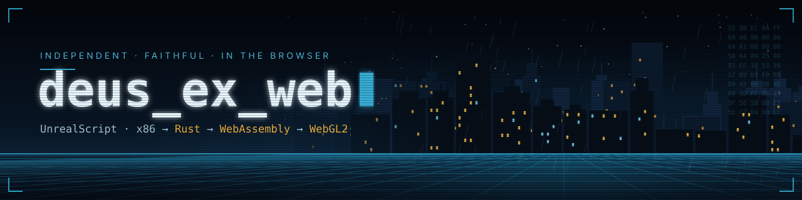
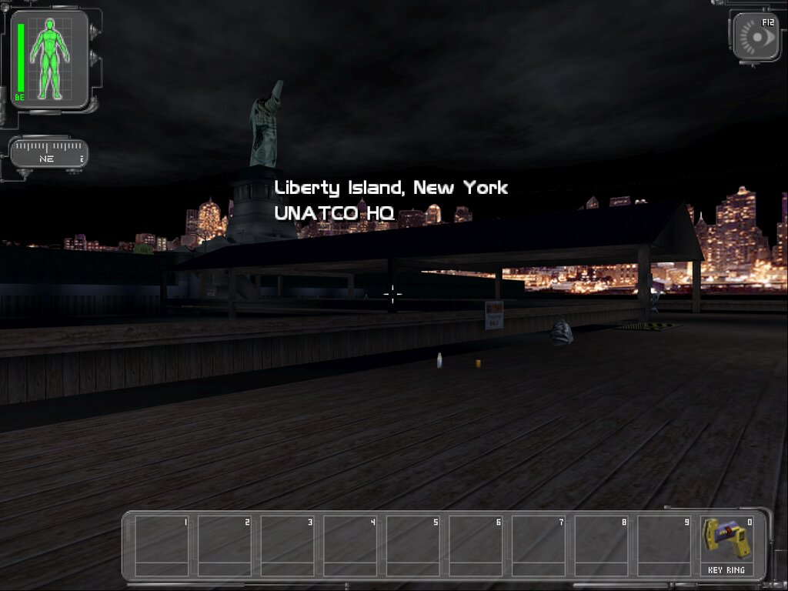
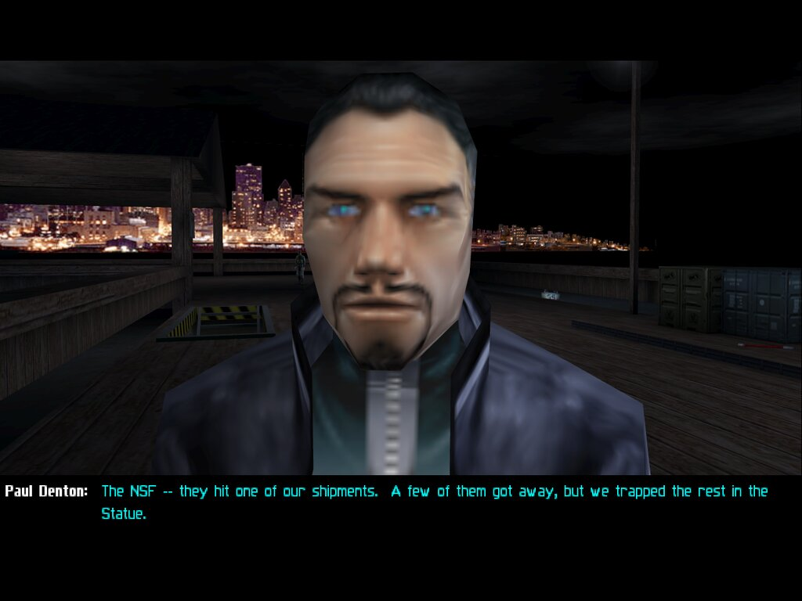
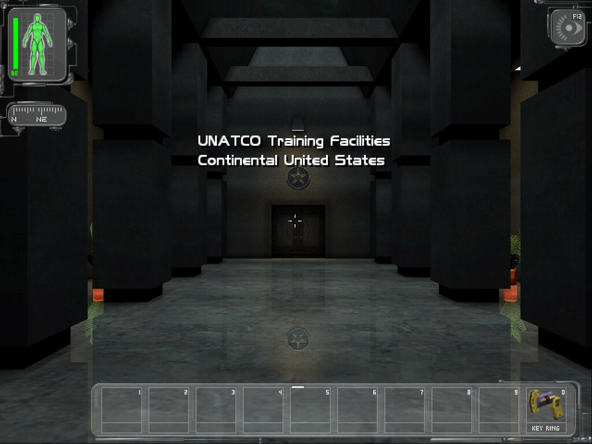
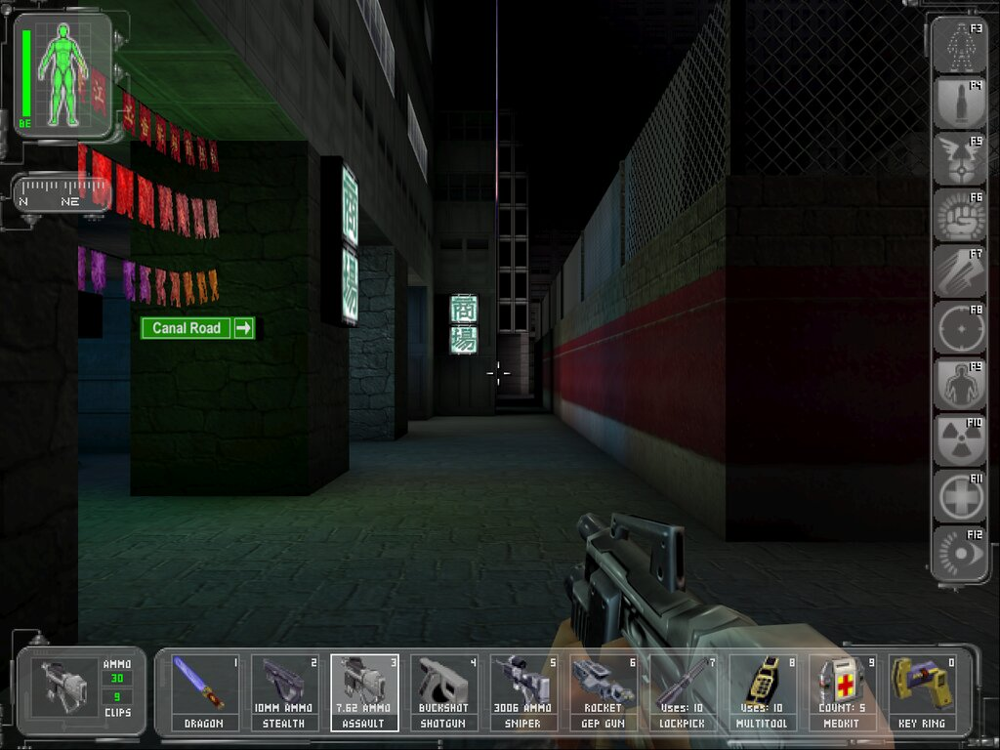
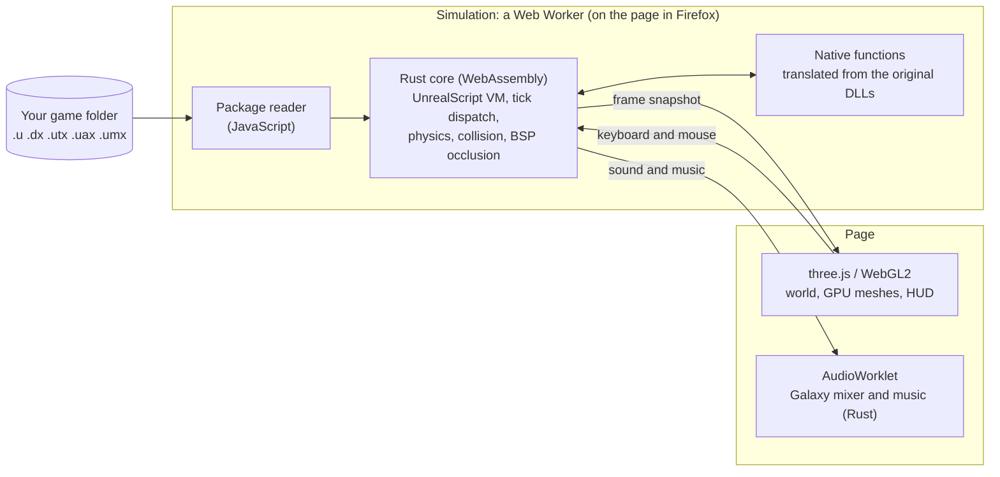

<p align="center">
  
</p>

<p align="center">
  <strong>English</strong> · <a href="README.fr.md">Français</a> · <a href="README.zh-CN.md">简体中文</a>
</p>

# Deus Ex on the web

An independent reimplementation of **Deus Ex** (Ion Storm, 2000) that runs in a desktop
browser and aims to behave exactly like the original game.

**[Play it in your browser](https://rydgel.github.io/deus_ex_web/)** with your own copy of the game. You choose its folder,
the browser reads it locally, and nothing is uploaded.

It is not a remake, and it does not emulate the Windows game. Your own copy of the game
supplies the maps, textures, sounds, music and compiled UnrealScript. This project runs
that bytecode in its own virtual machine, and it reimplements the engine's native code
from analysis of the original x86 binaries. Each behavior is checked against the
original: its DLLs run under a CPU emulator for routine-by-routine comparisons, and the
game itself runs under Wine to record reference traces and frames.

The simulation core is written in **Rust and compiled to WebAssembly**. JavaScript is the
host glue: **three.js and WebGL2** draw the picture, **Web Audio** plays sound and music,
and a **Web Worker** keeps the simulation off the page's main thread.

> [!IMPORTANT]
> This repository contains **no game files**. To play, you need your own legally
> obtained copy of Deus Ex, such as *Deus Ex: Game of the Year Edition* from GOG or
> Steam. See [Legal](#legal).

<table>
  <tr>
    <td width="50%"></td>
    <td width="50%"></td>
  </tr>
  <tr>
    <td align="center"><sub>Liberty Island at the start of the first mission</sub></td>
    <td align="center"><sub>Meeting Paul: the conversation camera and subtitles</sub></td>
  </tr>
  <tr>
    <td width="50%"></td>
    <td width="50%"></td>
  </tr>
  <tr>
    <td align="center"><sub>The training facility</sub></td>
    <td align="center"><sub>Hong Kong's Wan Chai market: the HUD, with the debugging page's loadout</sub></td>
  </tr>
</table>

<sub>Screenshots of the browser version in Chromium on Linux, in the original's 4:3 shape. They show the game's
original artwork, read from a local copy of the game.</sub>

**Contents:** [Status](#status) · [Getting started](#getting-started) ·
[Controls](#controls) · [Saves](#saves) · [How it works](#how-it-works) ·
[How fidelity is checked](#how-fidelity-is-checked) · [Performance](#performance) ·
[Contributing](#contributing) · [Documentation](#documentation) · [Legal](#legal) ·
[License](#license)

## Status

The work is split into stages ([roadmap](docs/roadmap.md)). Each stage closes on a fixed
list of criteria. For the game's behavior, each criterion is a comparison with the original.

| Stage | Scope | Status |
| --- | --- | --- |
| 0–2 | Read the original packages, draw maps with their lighting, a first playable slice | Done (two Stage 2 checks deferred) |
| 3 | The script runtime and the engine's native functions | Done: Training passes its gate, and all 83 single-player maps start and run |
| 4 | Presentation: meshes, lighting, effects, HUD, menus, sound and music | Done (2026-10-17): 70 of 70 criteria |
| 5 | Gameplay: movement, AI, combat, stealth, skills, augmentations, conversations | Done (2026-10-21): 50 of 50 scenarios |
| 6 | Saves, map travel and the whole campaign | Done (2026-10-26): 54 of 54 rows |
| 7 | Browser support, performance and reliability | Done (2026-11-12): 23 rows pass, 10 accepted without their checks by hand or a last Mac run, 4 excluded ([criteria](docs/stage-7-exit-criteria.md#stage-7-close)) |

In practice, the page starts the way the original does: the splash screen, the logo map
with its camera flight, then the main menu. From there you can start a new game, play
Training, save and load. One automated run played from New Game through every mission to
one of the endings in a single process (86 map changes). The state carried from each
mission into the next matched the original's.

What runs, from translated original code:

- Movement and physics: walking, jumping, crouching, falling, ladders and swimming. Doors
  and lifts work, and you can push, carry and throw objects.
- Combat and stealth: weapons, NPCs that see, hear, patrol, fight and raise alarms,
  security cameras, turrets, laser tripwires and explosions.
- Character systems: the inventory and belt, skills, augmentations, lockpicks and
  multitools, keypads, computers and datacubes.
- Conversations, DataLinks and InfoLink messages, with subtitles, speech, lip sync and
  the conversation camera.
- The original HUD and menus, including the options screens and key rebinding.
- The original renderer's look: light maps, moving lights, mesh lighting, mirrors, fog,
  coronas, particles, decals and animated textures.
- Music and sound through a reimplementation of the game's Galaxy audio engine.
- The intro, the credits and the three endings.

Limits:

- "Done" means the stage's criteria pass. It does not mean that every interaction on every
  map has been compared with the original. Stage 5's scenarios are on Training and Liberty
  Island. Stage 6 compares each mission's scripted chain of steps, not free play. Elsewhere
  the game runs from translated original code, but has not been checked case by case, so
  expect bugs.
- Multiplayer, gamepads, touch screens and the screenshot key are not supported.
- Safari is not supported: Stage 7 dropped it, and it has not been tested.
- Windows is outside the tests: Stage 7 excluded it, and no check has been run there. Friends
  have played an earlier build on Windows, and that is all that is known about it.
- Stage 7's [checks by hand](docs/stage-7-hand-checks.md) were not run: a real hidden tab,
  system sleep, a held Escape in fullscreen, a zoom or another screen, the system's folder
  picker and the storage prompt. Their headless halves pass.

The detailed record is in [project status](docs/status.md), and each stage's exit criteria
document lists what it proves and what stays open.

## Getting started

### Play in the browser

A build is published at <https://rydgel.github.io/deus_ex_web/>. Open it in Chrome or Firefox on a
computer, choose the folder your copy of the game is installed in, and play. The browser reads
the files locally; nothing is uploaded. The rest of this section is for building the project
yourself.

### Requirements

- **Node.js 22.12** or newer, with npm.
- **Rust** with the `wasm32-unknown-unknown` target (tested with Rust 1.99, installed
  through [rustup](https://rustup.rs)). This is required: the game's core is compiled
  from the three crates in `native/`.
- **Deus Ex: Game of the Year Edition.** The project is developed against the GOG release,
  version 1.112fm. Other 1.112fm releases, such as Steam's GOTY Edition, are expected to
  work but have not been tested.
- A desktop browser with WebGL2 and WebAssembly (see [Supported browsers](#supported-browsers)),
  a keyboard and a mouse.

### 1. Get the code

```sh
git clone https://github.com/Rydgel/deus_ex_web.git
cd deus_ex_web
npm ci
rustup target add wasm32-unknown-unknown
```

### 2. Add your game files

Put your installed game folder in the repository root, under the name
`Deus Ex GOTY Edition`. You can copy it from where GOG or Steam installed the game, or
make a symbolic link to it.

```text
deus_ex_web/
└── Deus Ex GOTY Edition/
    ├── Help/
    ├── Maps/
    ├── Music/
    ├── Sounds/
    ├── System/      (contains DeusEx.u)
    └── Textures/
```

Git ignores this folder. A folder named `game/` works too, or you can set
`DEUS_EX_GAME_DIR` to the installation's path.

You can also skip this step. When the page finds no game folder, it asks you to choose
one, and the browser reads the files locally. Nothing is uploaded.

### 3. Build and run

```sh
npm run build:wasm
npm run dev
```

`npm run build:wasm` compiles the Rust crates to WebAssembly. `npm run dev` also runs it
before it starts the development server, so you only need it on its own after you change
Rust code.

Open <http://127.0.0.1:5173>. The page starts like the original. Click the picture to
capture the mouse, press <kbd>Escape</kbd> for the main menu, then choose New Game,
Training or Load Game.

`http://127.0.0.1:5173/?debug=1` opens the developer page, with a map list, a free
inspection camera and diagnostics. The [development guide](docs/development.md) describes it.

To try the production build locally:

```sh
npm run build
npm run preview
```

The preview runs at <http://127.0.0.1:5174> and always asks for the game folder. The
build never contains game data.

### Supported browsers

| Browser | Status |
| --- | --- |
| Chrome, Chromium (macOS, Linux) | Tested. The simulation runs in a Web Worker. |
| Firefox (macOS, Linux) | Tested. The simulation runs on the page, where Firefox's garbage collector pauses less. |
| Edge and other Chromium browsers | Expected to behave like Chrome. Not tested. |
| Safari | Not supported (dropped from Stage 7 on 2026-11-10). It has no Keyboard Lock and cannot save to a folder. |
| Phones and tablets | Not supported: the game needs a keyboard and a mouse. |

The browser test suite passes 53 of 53 tests in Chromium and Firefox on Linux, on Stage 7's
closing commit (2026-11-12).
Windows is outside these tests, because neither development machine runs it. Friends have
played an earlier build there; reports from Windows are welcome.

## Controls

The keys are the original's defaults from `DefUser.ini`, kept as they were in 2000. For
example, <kbd>R</kbd> looks up and <kbd>;</kbd> reloads. You can change them in the game,
under Options → Controls → Customize Keys, and the page remembers your changes. Keys are
read by their position on the keyboard, as on a US QWERTY layout: on an AZERTY keyboard,
for example, you move with <kbd>Z</kbd> <kbd>Q</kbd> <kbd>S</kbd> <kbd>D</kbd>.

| Action | Keys |
| --- | --- |
| Move, strafe | <kbd>W</kbd> <kbd>A</kbd> <kbd>S</kbd> <kbd>D</kbd> or the arrow keys |
| Look | Mouse |
| Jump | <kbd>Space</kbd> |
| Crouch | <kbd>X</kbd> |
| Walk (hold) / toggle walking | <kbd>Shift</kbd> / <kbd>Caps Lock</kbd> |
| Lean left / right | <kbd>Q</kbd> / <kbd>E</kbd> |
| Look up / down, center the view | <kbd>R</kbd> / <kbd>V</kbd>, <kbd>F</kbd> |
| Turn left / right | <kbd>Z</kbd> / <kbd>C</kbd> |
| Fire or attack | Left mouse button |
| Use, open, pick up | Right mouse button |
| Drop the item in hand / put it away | Middle mouse button or <kbd>Tab</kbd> / <kbd>Backspace</kbd> |
| Select a belt item | <kbd>0</kbd>–<kbd>9</kbd>, mouse wheel |
| Reload / change ammunition | <kbd>;</kbd> / <kbd>'</kbd> |
| Scope / laser sight | <kbd>[</kbd> / <kbd>]</kbd> |
| Augmentations | <kbd>F3</kbd>–<kbd>F12</kbd> |
| Inventory / goals and notes | <kbd>F1</kbd> or <kbd>I</kbd> / <kbd>F2</kbd> or <kbd>G</kbd> |
| Main menu / pause | <kbd>Escape</kbd> / <kbd>Pause</kbd> |
| Quick save / quick load | Numpad <kbd>+</kbd> / Numpad <kbd>/</kbd> |

In the browser:

- **Mouse.** The first click in the picture captures the mouse pointer. In a window,
  <kbd>Escape</kbd> opens the main menu and the browser also releases the pointer; click
  again to capture it.
- **Fullscreen.** <kbd>Alt</kbd>+<kbd>Enter</kbd>, the original's fullscreen key, switches
  fullscreen on and off. The Display menu's Full-Screen option does the same.
- **Reserved keys.** In Chrome's fullscreen, Keyboard Lock gives the game the keys a
  browser normally keeps for itself, such as <kbd>F1</kbd>–<kbd>F12</kbd> and
  <kbd>Tab</kbd>. Hold <kbd>Escape</kbd> for about two seconds to leave fullscreen.
  Firefox and Safari have no Keyboard Lock, so <kbd>F11</kbd> and the browser's own
  shortcuts stay with the browser.
- **Browser shortcuts.** Outside fullscreen, <kbd>Ctrl</kbd> and <kbd>⌘</kbd> shortcuts,
  such as reload or opening a new tab, still work. No page can take system shortcuts such
  as <kbd>Alt</kbd>+<kbd>Tab</kbd> or <kbd>⌘</kbd>+<kbd>Q</kbd>.
- **Pausing.** The game pauses when the window loses focus.

Every binding, with the browser key it comes from and what it was checked to do, is listed
in [input bindings](docs/input-bindings.md).

## Saves

Saves use the original format. A save is the same folder of `.dxs` files that the desktop
game writes (`Save0001/SaveInfo.dxs` plus one file per visited map). The desktop game's
saves load here: 41 of 41 real saves from other players' playthroughs load. The original
game, run under Wine, loads saves made here (checked with several saves).

Where they are kept:

- **In the browser** by default, in IndexedDB.
- **In a folder on disk**, in Chrome and other Chromium browsers (File System Access API). You can choose the
  desktop game's own `Save` folder or the game folder, in which case its `Save` subfolder
  is used. The browser asks for permission again on a later visit.
- **Import and export** in Firefox and Safari, which cannot write to a folder: import a
  desktop `Save` folder, or export your saves as a zip.
- The development server also lists the installation's own `Save` folder, read-only.

Use the game's Save Game and Load Game screens, or the quick save and quick load keys. The
page's Saves window, which picks a folder, imports and exports, opens from the **Saves**
button beside the picture while a menu is open. Browsers can clear a site's storage (Safari
does after seven days without a visit), so keep a folder or an export of saves you care
about. Settings changed in the options menus are kept in the browser too. Details:
[save storage](docs/save-storage.md).

## How it works



- **Packages.** A reader written for this project decodes the original Unreal packages:
  maps, textures, meshes, sounds, music and script classes. It runs in Node and in the
  browser.
- **Scripts.** The game's logic is the original compiled UnrealScript. A virtual machine
  in the Rust core runs that bytecode as it is. It is not decompiled or rewritten.
- **Native code.** The engine's C++ functions (physics, collision, AI queries, the window
  system, rendering and audio) are reimplemented from analysis of the original x86 DLLs.
  Hot paths are in Rust; the rest is JavaScript.
- **Rendering** follows the original renderer's own steps: BSP occlusion, light maps, mesh
  lighting, mirrors and fog. WebGL2 draws the result, and mesh animation and lighting run
  on the GPU, bit-exact with the CPU code.
- **Audio.** The Galaxy sequencer and mixer run in Rust inside an AudioWorklet.
- **No Windows code runs in the game.** The original DLLs are used only by the optional
  local comparison tools.

| Path | Contents |
| --- | --- |
| `src/unreal/` | Package, object, map, texture and geometry decoding |
| `src/runtime/` | Script runtime host, native functions, collision, physics, Galaxy audio, Wasm wrappers |
| `src/viewer/` | The page: rendering, the simulation worker and its client, HUD, audio output, diagnostics |
| `native/` | Rust crates compiled to WebAssembly: `script-vm`, `lodmesh-kernel`, `galaxy-kernel` |
| `scripts/` | Validators, native-code oracles, censuses, profiling |
| `tools/` | Capture helpers for the original game |
| `test/`, `browser-tests/` | Unit tests and the Playwright browser suite |
| `docs/` | Research notes, recovered behavior, evidence and the roadmap |

## How fidelity is checked

The rule ([AGENTS.md](AGENTS.md)): each behavior comes from original evidence, meaning game
data, bytecode, native instructions or measurements of the original game, and is compared
with the original. Lookalike substitutes are not accepted, and behavior without enough
evidence is marked unsupported.

- **Native oracles.** The original DLLs from your installation, checked by hash, run in the
  [Unicorn](https://www.unicorn-engine.org) CPU emulator. A translated routine gets the
  same inputs and must produce the same results, memory and events, bit for bit. This
  includes the rounding of x87 floating-point math.
- **Traces of the running game.** The original runs under Wine (Linux) or CrossOver (macOS)
  with a tracer that records the watched actors, the random number stream, AI events and
  object creation on every tick. The browser version replays the same inputs and must match
  it tick by tick.
- **Matched frames.** Screenshots of the original and of the browser version are taken
  with the same camera at the same level time, then compared: 26 maps, 122 of 130 views.
- **Campaign chains.** Each mission's scripted route runs in both from the same save, and
  the flags, door states and travel text are compared at every step.

The checks:

```sh
npm test                       # unit tests (builds the Wasm, then node --test test/*.test.mjs)
npm run validate -- --jobs 4   # the validator sweep, scripts/validate-*.mjs, four jobs in parallel
npx playwright install chromium firefox
npm run test:browser           # the browser suite (Chromium and Firefox; WebKit on macOS)
```

Most validators read the game folder. The native comparisons need a Python environment with
Unicorn and Capstone:

```sh
python3 -m venv .cache/native-probe-env
.cache/native-probe-env/bin/pip install capstone==5.0.9 unicorn==2.1.4
```

Comparisons with the running game use recorded captures, which stay outside Git. A check
whose capture is missing reports SKIP. The [development guide](docs/development.md) covers
the stage gates, the runner's memory limits and the inspection tools.

## Performance

The target is 60 fps, which means 16.7 ms of host work per frame on the reference machine
(an Apple M2 Pro at 1440×960), without changing what the simulation computes. It was
120 fps until 2026-11-05. Stage 7 measured it on a set of ten maps, in Chrome and Firefox
on that Mac (November 2026):

- In Chrome, the simulation runs in a Web Worker, so simulating and drawing overlap. A
  map's median frame work is 2.1 to 4.0 ms in the worker and 0.9 to 2.2 ms on the page.
- On a 120 Hz display, 95% of drawn frames take at most 9.2 to 10.1 ms in Chrome and 9.3
  to 10.3 ms in Firefox, depending on the map.
- Hot paths run in Rust and WebAssembly, mesh animation and lighting run on the GPU, and no
  shader is compiled during play after a map loads.
- Loading, on the production build: the logo map's first frame in 3.5 to 3.9 s (Chrome) and
  5.7 to 7.2 s (Firefox); a map change's first frame in 1.15 s (Chrome) and 3.03 s
  (Firefox), the median over all 83 maps; Load Game in 1.31 s and 3.94 s.
- Memory: each map of the set stays within 1.25 GB for the page and the worker together,
  and a one-hour session runs without errors or growing memory in both browsers.

Still open: on Linux, Firefox's longest garbage collections can still cause more hitches
over 50 ms than Stage 7's bound allows (two of four Island runs stay within it; the Mac
passes). `?hitchlog=1` records the timing of every frame
([hitch recorder](docs/hitch-log.md)).

## Contributing

Read [AGENTS.md](AGENTS.md) first. In short:

- Start from the original. Find the responsible data, bytecode or native routine, write
  down what it does, and build reference cases before changing the game in the browser.
- Never commit original game files, extracted scripts, binaries or captures.
- New runtime work goes in the Rust core. JavaScript is for host glue: rendering, the page,
  Web Audio and validators.
- Run the focused validators for what you changed and `npm test`. Run the full sweep with
  `npm run validate -- --jobs 4` when a change is wide.
- Judge a performance change by interleaved A/B medians. Fidelity comes first.
- Single-player comes first; multiplayer is the last priority.

## Documentation

`docs/` holds about 400 notes, roughly one per subsystem, each with its evidence. Good
places to start:

- [Roadmap](docs/roadmap.md) and [project status](docs/status.md)
- Exit criteria: [Stage 3](docs/stage-3-exit-criteria.md), [Stage 4](docs/stage-4-exit-criteria.md),
  [Stage 5](docs/stage-5-exit-criteria.md), [Stage 6](docs/stage-6-exit-criteria.md),
  [Stage 7](docs/stage-7-exit-criteria.md)
- [Development guide](docs/development.md): the debugging page, URL switches, validators,
  inspection tools
- Architecture: [Rust core](docs/rust-core.md), [simulation worker](docs/sim-worker.md),
  [GPU meshes](docs/gpu-mesh.md), [BSP occlusion](docs/bsp-occlusion.md),
  [Galaxy music](docs/galaxy-music.md), [Galaxy audio](docs/galaxy-audio.md)
- The game's start and travel: [start](docs/boot.md), [travel, saving and loading](docs/travel.md),
  [save storage](docs/save-storage.md)
- Verification: [native exec diff](docs/native-exec-diff.md), [visual acceptance](docs/visual-acceptance.md)
- Performance: [frame cost](docs/play-frame-cost.md), [live heap](docs/live-heap.md),
  [hitch recorder](docs/hitch-log.md)

## Legal

- This is an independent project. It is not affiliated with, endorsed by or sponsored by
  Eidos, Square Enix, Embracer Group or any other holder of the rights to Deus Ex.
- Deus Ex is a trademark of its owner. The name is used only to say which game this
  project works with.
- The repository does not include or distribute any of the original game's files: no maps,
  textures, sounds, music, script packages or extracted scripts, executables or DLLs.
  Original files are read only from a copy that you provide, on your own machine.
- The screenshots in `docs/readme/` are captures of this project running, and show artwork
  from the original game.
- To play, you need your own legally obtained copy of the game.
- This section describes the project. It is not legal advice and does not promise anything
  about the project's legal status in any country.

## License

Copyright (C) 2026 Jerome Mahuet and contributors.

This project is free software: you can redistribute it and/or modify it under the terms of
the [GNU Affero General Public License](LICENSE) as published by the Free Software
Foundation, either version 3 of the License, or (at your option) any later version. It is
distributed in the hope that it will be useful, but WITHOUT ANY WARRANTY; see the license
for details.

In short: anyone who distributes this project or a modified version of it, or runs a
modified version as a public website or service, must make its complete source available
under the same license. No closed or proprietary version can be made of it.

The license covers this project's own code and documentation only. It grants nothing in Deus
Ex itself: the game's files are not part of this repository and remain the property of
their rights holders (see [Legal](#legal)).

Third-party code in the repository keeps its own license. The CRT display shaders in
`src/viewer/shaders/` come from libretro and other authors under the GPL (CRT-Royale
GPL-2.0-or-later; CRT-Aperture and CRT-EasyMode, version unspecified), public domain
(CRT-Lottes) or MIT/Unlicense (SatPixie) ([details](src/viewer/shaders/README.md)); all are
compatible with the AGPL. Dependencies installed by npm, such as three.js (MIT), have their
own licenses.

## Acknowledgements

Deus Ex was created by Ion Storm and published by Eidos Interactive in 2000. This project
uses [three.js](https://threejs.org), [Vite](https://vite.dev) and
[Playwright](https://playwright.dev). Its research relies on
[Unicorn](https://www.unicorn-engine.org), [Capstone](https://www.capstone-engine.org),
[Wine](https://www.winehq.org) and CrossOver. [SurrealEngine](https://github.com/dpjudas/SurrealEngine)'s
package readers served as a reference for the file formats.
