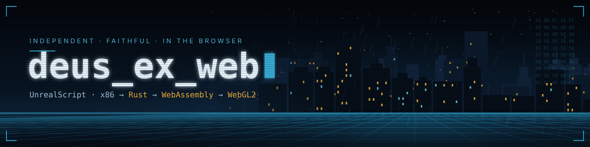
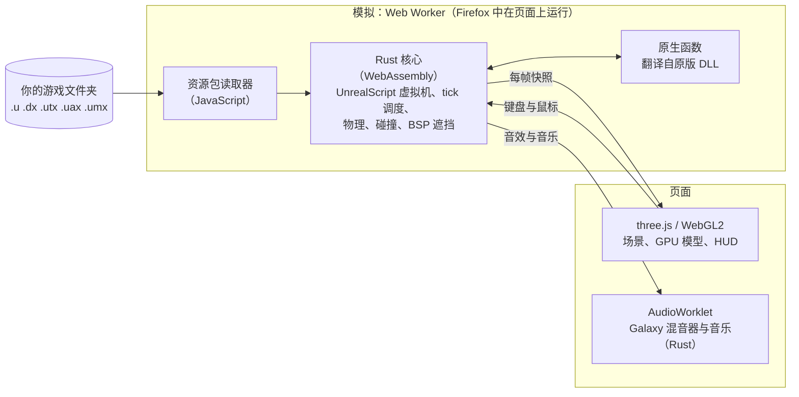

<p align="center">
  
</p>

<p align="center">
  <a href="README.md">English</a> · <a href="README.fr.md">Français</a> · <strong>简体中文</strong>
</p>

# Deus Ex 网页版

这是对《杀出重围》（**Deus Ex**，Ion Storm，2000 年）的独立重新实现，运行在桌面浏览器中，目标是在行为上与原版游戏完全一致。

它不是重制版，也不是在浏览器里模拟 Windows 版游戏。地图、贴图、音效、音乐和编译后的 UnrealScript 都来自你自己的游戏副本。本项目用自己编写的虚拟机直接运行这些字节码，并通过分析原版 x86 二进制文件，重新实现引擎的原生代码。每一项行为都与原版对照检验：原版 DLL 在 CPU 模拟器中运行，逐个函数地比较；游戏本身则在 Wine 下运行，用来录制参考轨迹和参考画面。

模拟核心用 **Rust 编写并编译为 WebAssembly**。JavaScript 负责与浏览器对接：**three.js 和 WebGL2** 绘制画面，**Web Audio** 播放音效和音乐，**Web Worker** 让模拟在页面主线程之外运行。

> [!IMPORTANT]
> 本仓库**不包含任何游戏文件**。要游玩，你需要自己合法获得的 Deus Ex 副本，例如 GOG 或 Steam 上的 *Deus Ex: Game of the Year Edition*。详见[法律声明](#法律声明)。

**目录：** [进度](#进度) · [快速开始](#快速开始) · [操作](#操作) · [存档](#存档) · [工作原理](#工作原理) · [如何检验还原度](#如何检验还原度) · [性能](#性能) · [参与贡献](#参与贡献) · [文档](#文档) · [法律声明](#法律声明) · [许可证](#许可证)

`docs/` 目录中的详细文档为英文。

## 进度

开发分为若干阶段（[路线图](docs/roadmap.md)）。每个阶段都以一份固定的验收标准收尾。凡是涉及游戏行为的标准，都是与原版的对照。

| 阶段 | 范围 | 状态 |
| --- | --- | --- |
| 0–2 | 读取原版资源包，带光照渲染地图，第一个可玩片段 | 已完成（第 2 阶段有两项检验推迟） |
| 3 | 脚本运行时与引擎原生函数 | 已完成：Training 通过验收，83 张单人地图全部能启动并运行 |
| 4 | 表现层：模型、光照、特效、HUD、菜单、音效与音乐 | 已完成（2026-10-17）：70 项标准全部通过 |
| 5 | 玩法：移动、AI、战斗、潜行、技能、增强能力、对话 | 已完成（2026-10-21）：50 个场景全部通过 |
| 6 | 存档、地图切换与完整战役 | 已完成（2026-10-26）：54 项全部通过 |
| 7 | 浏览器兼容性、性能与稳定性 | 进行中（[验收标准](docs/stage-7-exit-criteria.md)） |

实际体验上，页面的启动过程与原版相同：启动画面，带镜头飞行的标志地图，然后是主菜单。在这里可以开始新游戏、进入 Training 训练关卡，以及存档和读档。一次自动化运行在同一个进程中从 New Game 出发，走完所有任务直到其中一个结局（共切换地图 86 次），每个任务带入下一个任务的状态都与原版一致。

以下内容都由翻译自原版的代码运行：

- 移动与物理：行走、跳跃、蹲伏、坠落、梯子和游泳。门和电梯都能使用，物体可以推、搬和扔。
- 战斗与潜行：各种武器，会看、会听、会巡逻、会战斗、会拉响警报的 NPC，监控摄像头、炮塔、激光绊线和爆炸。
- 角色系统：物品栏与快捷栏、技能、增强能力、开锁器和万用工具、密码键盘、电脑和数据立方。
- 对话、DataLink 与 InfoLink 通讯，带字幕、语音、口型同步和对话镜头。
- 原版 HUD 和菜单，包括设置界面和按键重新绑定。
- 原版渲染器的画面：光照贴图、移动光源、模型光照、镜面、雾、光晕、粒子、贴花和动画贴图。
- 音乐与音效：重新实现了游戏所用的 Galaxy 音频引擎。
- 开场动画、制作人员名单和三个结局。

局限：

- “已完成”指该阶段的验收标准全部通过，并不代表每张地图上的每个交互都与原版逐一对照过。第 5 阶段的场景位于 Training 和自由女神岛（Liberty Island）。第 6 阶段比较的是每个任务中按脚本推进的步骤，而不是自由游玩。其余部分同样运行翻译自原版的代码，但没有逐一检验，所以难免有 bug。
- 不支持多人游戏、手柄、触摸屏和截图键。
- 尚未在 Safari 和 Windows 上测试。

详细记录见[项目进度](docs/status.md)。每个阶段的验收文档都写明了它证明了什么、还有哪些问题没有解决。

## 快速开始

### 环境要求

- **Node.js 22.12** 或更高版本（含 npm）。
- **Rust**，并安装 `wasm32-unknown-unknown` 目标（已用 Rust 1.99 测试，可通过 [rustup](https://rustup.rs) 安装）。这是必需的：游戏核心由 `native/` 中的三个 crate 编译而成。
- **Deus Ex: Game of the Year Edition。** 本项目基于 GOG 版（1.112fm）开发。其他 1.112fm 版本（例如 Steam 上的 GOTY Edition）应该也能运行，但尚未测试。
- 支持 WebGL2 和 WebAssembly 的桌面浏览器（见[支持的浏览器](#支持的浏览器)），以及键盘和鼠标。

### 1. 获取代码

```sh
git clone https://github.com/Rydgel/deus_ex_web.git
cd deus_ex_web
npm ci
rustup target add wasm32-unknown-unknown
```

### 2. 放入游戏文件

把已安装的游戏文件夹放到仓库根目录下，并命名为 `Deus Ex GOTY Edition`。可以从 GOG 或 Steam 的安装位置复制过来，也可以建立一个符号链接。

```text
deus_ex_web/
└── Deus Ex GOTY Edition/
    ├── Help/
    ├── Maps/
    ├── Music/
    ├── Sounds/
    ├── System/      （包含 DeusEx.u）
    └── Textures/
```

Git 会忽略这个文件夹。也可以命名为 `game/`，或者用环境变量 `DEUS_EX_GAME_DIR` 指向安装路径。

这一步也可以跳过。页面找不到游戏文件夹时，会请你选择一个，文件由浏览器在本地读取，不会上传到任何地方。

### 3. 构建并运行

```sh
npm run build:wasm
npm run dev
```

`npm run build:wasm` 把 Rust crate 编译为 WebAssembly。`npm run dev` 在启动开发服务器之前也会自动执行这一步，所以只有修改了 Rust 代码之后才需要单独运行它。

打开 <http://127.0.0.1:5173>。页面会像原版一样启动。点击画面以捕获鼠标，按 <kbd>Esc</kbd> 打开主菜单，然后选择 New Game、Training 或 Load Game。

`http://127.0.0.1:5173/?debug=1` 是开发者页面，提供地图列表、自由观察镜头和诊断工具，详见[开发指南](docs/development.md)。

在本地试用生产构建：

```sh
npm run build
npm run preview
```

预览地址为 <http://127.0.0.1:5174>，每次都会要求选择游戏文件夹。构建产物中绝不包含游戏数据。

### 支持的浏览器

| 浏览器 | 状态 |
| --- | --- |
| Chrome、Chromium（macOS、Linux） | 已测试。模拟在 Web Worker 中运行。 |
| Firefox（macOS、Linux） | 已测试。模拟在页面上运行，这样 Firefox 的垃圾回收停顿更少。 |
| Edge 及其他 Chromium 内核浏览器 | 预计与 Chrome 表现相同，尚未测试。 |
| Safari | 尚未测试。它不支持 Keyboard Lock，也无法把存档写入文件夹。 |
| 手机和平板 | 不支持：游戏需要键盘和鼠标。 |

浏览器测试套件在 Linux 上的 Chromium 和 Firefox 中 41 项全部通过（2026-10-28）。由于两台开发机都不运行 Windows，Windows 尚未测试。

## 操作

按键沿用原版 `DefUser.ini` 中的默认设置，与 2000 年时完全一样，例如 <kbd>R</kbd> 是向上看，<kbd>;</kbd> 是换弹。可以在游戏的 Options → Controls → Customize Keys 中修改，页面会记住你的修改。按键按其在键盘上的位置识别（以美式 QWERTY 布局为准）。

| 动作 | 按键 |
| --- | --- |
| 移动、平移 | <kbd>W</kbd> <kbd>A</kbd> <kbd>S</kbd> <kbd>D</kbd> 或方向键 |
| 环顾 | 鼠标 |
| 跳跃 | <kbd>Space</kbd> |
| 蹲伏 | <kbd>X</kbd> |
| 慢走（按住）/ 切换慢走 | <kbd>Shift</kbd> / <kbd>Caps Lock</kbd> |
| 向左 / 向右探身 | <kbd>Q</kbd> / <kbd>E</kbd> |
| 向上 / 向下看，视角回正 | <kbd>R</kbd> / <kbd>V</kbd>，<kbd>F</kbd> |
| 向左 / 向右转 | <kbd>Z</kbd> / <kbd>C</kbd> |
| 开火、攻击 | 鼠标左键 |
| 使用、打开、拾取 | 鼠标右键 |
| 丢下手中物品 / 收起 | 鼠标中键或 <kbd>Tab</kbd> / <kbd>Backspace</kbd> |
| 选择快捷栏物品 | <kbd>0</kbd>–<kbd>9</kbd>，鼠标滚轮 |
| 换弹 / 切换弹药 | <kbd>;</kbd> / <kbd>'</kbd> |
| 瞄准镜 / 激光瞄准 | <kbd>[</kbd> / <kbd>]</kbd> |
| 增强能力 | <kbd>F3</kbd>–<kbd>F12</kbd> |
| 物品栏 / 目标与笔记 | <kbd>F1</kbd> 或 <kbd>I</kbd> / <kbd>F2</kbd> 或 <kbd>G</kbd> |
| 主菜单 / 暂停 | <kbd>Esc</kbd> / <kbd>Pause</kbd> |
| 快速存档 / 快速读档 | 小键盘 <kbd>+</kbd> / 小键盘 <kbd>/</kbd> |

浏览器中的注意事项：

- **鼠标。** 第一次点击画面时会捕获鼠标指针。在窗口模式下，<kbd>Esc</kbd> 打开主菜单，同时浏览器也会释放指针，再次点击即可重新捕获。
- **全屏。** 原版的全屏键 <kbd>Alt</kbd>+<kbd>Enter</kbd> 用于切换全屏，Display 菜单里的 Full-Screen 选项效果相同。
- **浏览器保留的按键。** 在 Chrome 全屏模式下，Keyboard Lock 会把浏览器通常自己占用的按键交给游戏，例如 <kbd>F1</kbd>–<kbd>F12</kbd> 和 <kbd>Tab</kbd>。按住 <kbd>Esc</kbd> 约两秒即可退出全屏。Firefox 和 Safari 没有 Keyboard Lock，因此 <kbd>F11</kbd> 和浏览器快捷键仍归浏览器使用。
- **浏览器快捷键。** 非全屏时，带 <kbd>Ctrl</kbd> 或 <kbd>⌘</kbd> 的快捷键（如刷新页面、新建标签页）照常可用。任何网页都无法占用系统快捷键，例如 <kbd>Alt</kbd>+<kbd>Tab</kbd> 或 <kbd>⌘</kbd>+<kbd>Q</kbd>。
- **暂停。** 窗口失去焦点时游戏会暂停。

全部按键绑定，以及每个绑定对应的浏览器按键和检验结果，见 [input bindings](docs/input-bindings.md)。

## 存档

存档采用原版格式。一个存档就是桌面版游戏写出的同一组 `.dxs` 文件（`Save0001/SaveInfo.dxs`，外加每张去过的地图各一个文件）。桌面版的存档可以在这里读取：来自其他玩家实际游玩的 41 个真实存档全部能够载入。反过来，在 Wine 下运行的原版游戏也能读取这里生成的存档（已用多个存档验证）。

存档保存位置：

- **浏览器内**：默认保存在 IndexedDB 中。
- **磁盘上的文件夹**：适用于 Chrome 及其他 Chromium 内核浏览器（File System Access API）。可以选择桌面版自己的 `Save` 文件夹，也可以选择游戏文件夹，这时会使用其中的 `Save` 子文件夹。之后再次访问时，浏览器会重新请求权限。
- **导入与导出**：Firefox 和 Safari 无法写入文件夹，可以导入桌面版的 `Save` 文件夹，或者把存档导出为 zip。
- 开发服务器还会以只读方式列出安装目录自己的 `Save` 文件夹。

使用游戏里的 Save Game 和 Load Game 界面，或快速存档、快速读档键即可。页面自带的 Saves 窗口可以选择文件夹、导入和导出，打开任意菜单时画面旁会出现 **Saves** 按钮。浏览器可能会清除网站数据（Safari 会在七天未访问后清除），所以重要的存档请保存到文件夹或导出备份。在设置菜单中修改的选项同样保存在浏览器中。详见 [save storage](docs/save-storage.md)。

## 工作原理



- **资源包。** 本项目自己编写的读取器解析原版 Unreal 资源包：地图、贴图、模型、声音、音乐和脚本类。它既能在 Node 中运行，也能在浏览器中运行。
- **脚本。** 游戏逻辑就是原版编译好的 UnrealScript。Rust 核心中的虚拟机原样执行这些字节码，没有经过反编译或改写。
- **原生代码。** 引擎的 C++ 函数（物理、碰撞、AI 查询、窗口系统、渲染和音频）根据对原版 x86 DLL 的分析重新实现。性能关键的部分用 Rust，其余用 JavaScript。
- **渲染**遵循原版渲染器自身的步骤：BSP 遮挡、光照贴图、模型光照、镜面和雾。最终由 WebGL2 绘制；模型动画和光照在 GPU 上计算，结果与 CPU 代码逐位一致。
- **音频。** Galaxy 的音序器和混音器用 Rust 实现，运行在 AudioWorklet 中。
- **游戏运行时不执行任何 Windows 代码。** 原版 DLL 只用于可选的本地对照工具。

| 路径 | 内容 |
| --- | --- |
| `src/unreal/` | 资源包、对象、地图、贴图和几何数据的解析 |
| `src/runtime/` | 脚本运行时宿主、原生函数、碰撞、物理、Galaxy 音频、Wasm 封装 |
| `src/viewer/` | 页面部分：渲染、模拟 Worker 及其客户端、HUD、音频输出、诊断 |
| `native/` | 编译为 WebAssembly 的 Rust crate：`script-vm`、`lodmesh-kernel`、`galaxy-kernel` |
| `scripts/` | 验证脚本、原生代码对照（oracle）、普查、性能分析 |
| `tools/` | 针对原版游戏的采集工具 |
| `test/`、`browser-tests/` | 单元测试和 Playwright 浏览器测试套件 |
| `docs/` | 研究笔记、还原出的行为、证据和路线图 |

## 如何检验还原度

规则（[AGENTS.md](AGENTS.md)）：每一项行为都必须来自原版证据，即游戏数据、字节码、原生指令或对原版游戏的实测，并与原版对照。不接受“看起来差不多”的替代实现；证据不足的行为一律标记为不支持。

- **原生代码对照（oracle）。** 你安装目录中的原版 DLL（经哈希校验）在 [Unicorn](https://www.unicorn-engine.org) CPU 模拟器中运行。翻译后的函数接收相同的输入，必须产生逐位相同的结果、内存和事件，包括 x87 浮点运算的舍入。
- **运行中原版游戏的轨迹。** 原版在 Wine（Linux）或 CrossOver（macOS）下运行，由追踪器在每个 tick 记录被观察的 actor、随机数序列、AI 事件和对象创建。浏览器版重放相同的输入，必须逐 tick 一致。
- **同机位画面对比。** 用相同的镜头、在相同的关卡时间分别截取原版和浏览器版的画面进行比较：26 张地图，130 个视角中有 122 个一致。
- **战役流程链。** 每个任务按脚本设定的路线，从同一个存档出发，分别在两边运行，每一步都比较游戏标志（flag）、门的状态和跨地图传递的数据。

检验命令：

```sh
npm test                       # 单元测试（先编译 Wasm，再运行 node --test test/*.test.mjs）
npm run validate -- --jobs 4   # 全部验证脚本 scripts/validate-*.mjs，4 个并行
npx playwright install chromium firefox
npm run test:browser           # 浏览器测试套件（Chromium 和 Firefox；macOS 上还有 WebKit）
```

大多数验证脚本需要读取游戏文件夹。原生代码对照需要一个装有 Unicorn 和 Capstone 的 Python 环境：

```sh
python3 -m venv .cache/native-probe-env
.cache/native-probe-env/bin/pip install capstone==5.0.9 unicorn==2.1.4
```

与运行中原版游戏的对照依赖事先录制的采集数据，这些数据不纳入 Git；缺少采集数据的检查会显示 SKIP。各阶段的验收、运行器的内存限制和数据检查工具见[开发指南](docs/development.md)。

## 性能

目标是 120 fps，即在参考机器（Apple M2 Pro，1440×960）上每帧工作时间不超过 8.3 毫秒，同时不改变模拟的计算结果。目前的做法包括：

- 在 Chrome 中，模拟运行在 Web Worker 里，模拟与绘制可以同时进行。
- 性能关键的部分用 Rust 和 WebAssembly 实现，模型动画和光照在 GPU 上计算。
- 最近一轮优化（2026 年 10 月）消除了 Chrome 中由垃圾回收引起的卡顿：自由女神岛关卡中，模拟的 JavaScript 存活堆从约 820 万个对象降到 260 万个。在开发者的 Mac 上，Chrome 和 Firefox 现在都运行流畅。

尚待解决：地图载入后会短暂停顿一下；120 fps 的目标还没有在所有地图上达到；第 7 阶段的帧时间验收项还需要在参考机器上实测。`?hitchlog=1` 可以记录每一帧的耗时（[hitch recorder](docs/hitch-log.md)）。

## 参与贡献

请先阅读 [AGENTS.md](AGENTS.md)。简而言之：

- 从原版出发。先找出负责的数据、字节码或原生函数，记录它的行为，建立参考用例，然后再修改浏览器中的游戏。
- 绝不要提交原版游戏文件、提取出的脚本、二进制文件或采集数据。
- 新的运行时代码写在 Rust 核心中。JavaScript 只负责与宿主对接：渲染、页面、Web Audio 和验证脚本。
- 针对你的改动运行相应的验证脚本以及 `npm test`。改动范围较大时，用 `npm run validate -- --jobs 4` 运行全部验证。
- 性能改动以交错 A/B 测试的中位数为准，还原度优先。
- 单人模式优先，多人模式排在最后。

## 文档

`docs/` 中有约 400 篇英文笔记，大致每个子系统一篇，各自附有证据。建议从这里开始：

- [路线图](docs/roadmap.md)和[项目进度](docs/status.md)
- 验收标准：[第 3 阶段](docs/stage-3-exit-criteria.md)、[第 4 阶段](docs/stage-4-exit-criteria.md)、[第 5 阶段](docs/stage-5-exit-criteria.md)、[第 6 阶段](docs/stage-6-exit-criteria.md)、[第 7 阶段](docs/stage-7-exit-criteria.md)
- [开发指南](docs/development.md)：调试页面、URL 参数、验证脚本、数据检查工具
- 架构：[Rust 核心](docs/rust-core.md)、[模拟 Worker](docs/sim-worker.md)、[GPU 模型](docs/gpu-mesh.md)、[BSP 遮挡](docs/bsp-occlusion.md)、[Galaxy 音乐](docs/galaxy-music.md)、[Galaxy 音频](docs/galaxy-audio.md)
- 启动与地图切换：[启动流程](docs/boot.md)、[地图切换、存档与读档](docs/travel.md)、[存档存储](docs/save-storage.md)
- 检验：[原生代码对比](docs/native-exec-diff.md)、[画面验收](docs/visual-acceptance.md)
- 性能：[每帧开销](docs/play-frame-cost.md)、[存活堆](docs/live-heap.md)、[卡顿记录器](docs/hitch-log.md)

## 法律声明

- 本项目是独立项目，与 Eidos、Square Enix 或 Deus Ex 的任何其他权利人均无关联，也未获得其认可或赞助。
- Deus Ex 是其所有者的商标。此处使用该名称，仅为说明本项目适用于哪款游戏。
- 本仓库不包含、也不分发原版游戏的任何文件：没有地图、贴图、音效、音乐、脚本包或提取出的脚本，也没有可执行文件或 DLL。原版文件只会在你自己的电脑上，从你提供的副本中读取。
- 要游玩，你需要自己合法获得的游戏副本。
- 本节只是对项目的说明，不构成法律意见，也不对本项目在任何国家或地区的法律地位作出保证。

## 许可证

Copyright (C) 2026 Jerome Mahuet 及贡献者。

本项目是自由软件：你可以依据自由软件基金会发布的 [GNU Affero 通用公共许可证](LICENSE)第 3 版，或（由你选择）任何更新的版本，重新分发和/或修改本项目。发布本项目是希望它有用，但不提供任何担保；详情请参阅许可证。

简而言之：任何分发本项目或其修改版本的人，或将修改版本作为公开网站或服务运行的人，都必须以相同许可证提供完整源代码。任何人都不能据此制作闭源或专有版本。

该许可证仅涵盖本项目自身的代码和文档，不授予对《杀出重围》本身的任何权利：游戏文件不属于本仓库，其所有权归各自的权利人所有（参见[法律声明](#法律声明)）。

仓库中的第三方代码保留其各自的许可证。`src/viewer/shaders/` 中的 CRT 显示着色器来自 libretro 及其他作者：CRT-Royale 采用 GPL-2.0 或更新版本，CRT-Aperture 和 CRT-EasyMode 采用 GPL（未注明版本），CRT-Lottes 属于公有领域，SatPixie 采用 MIT/Unlicense（[详情](src/viewer/shaders/README.md)），均与 AGPL 兼容。通过 npm 安装的依赖（如 three.js，MIT 许可证）各有其许可证。

## 致谢

《杀出重围》（Deus Ex）由 Ion Storm 开发，Eidos Interactive 于 2000 年发行。本项目使用了 [three.js](https://threejs.org)、[Vite](https://vite.dev) 和 [Playwright](https://playwright.dev)。研究工作依靠 [Unicorn](https://www.unicorn-engine.org)、[Capstone](https://www.capstone-engine.org)、[Wine](https://www.winehq.org) 和 CrossOver。文件格式方面参考了 [SurrealEngine](https://github.com/dpjudas/SurrealEngine) 的资源包读取器。
